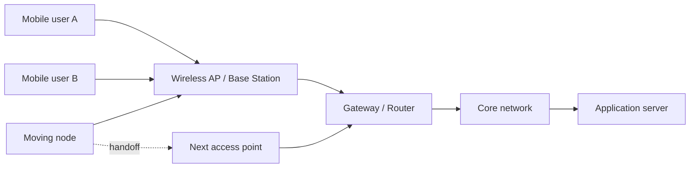

# Q1 – Wireless Network Architecture and Mobility Analysis (6 Marks)

## Aim
Represent a wireless network and examine how bandwidth, mobility, handoff and connectivity affect packet delivery.

## Architecture and component roles
- **Mobile nodes:** phones, tablets, laptops or vehicle terminals that send/receive data.
- **Access point/base station:** radio attachment point for mobile nodes.
- **Wireless link:** shared radio channel affected by interference, distance and signal strength.
- **Gateway/router:** forwards traffic between wireless access and the core network.
- **Application server:** receives messages and sends responses.

## Wireless characteristics
Wireless access supports mobility and flexible deployment. Radio bandwidth is shared; throughput can fall as users increase. Fading, interference and coverage gaps cause retransmission, delay and packet loss. A node may change attachment when another access point offers a better usable signal.

## Mobility and performance
The input dataset represents stationary, walking, vehicle and high-speed movement. Handoff adds temporary interruption. Increasing movement intensity raises the modelled handoff delay and loss probability. A successful handoff restores service through the new access point; a failed handoff leaves packets undelivered during the outage.

## Metrics
- PDR = delivered packets / sent packets × 100.
- Lost packets = sent packets − delivered packets.
- Estimated delay = base delay + configured handoff contribution.
- Bandwidth is configured link capacity, not guaranteed per-user throughput.

## Result
Wireless infrastructure enables communication through access points and gateways. Mobility causes handoff; limited bandwidth and weak connectivity can increase delay and loss. Run the program to create `outputs/Q1_Mobility_Results.csv`.

**Contribution:** Student A – architecture/components/bandwidth; Student B – mobility/handoff/performance; joint – scenario and interpretation.
