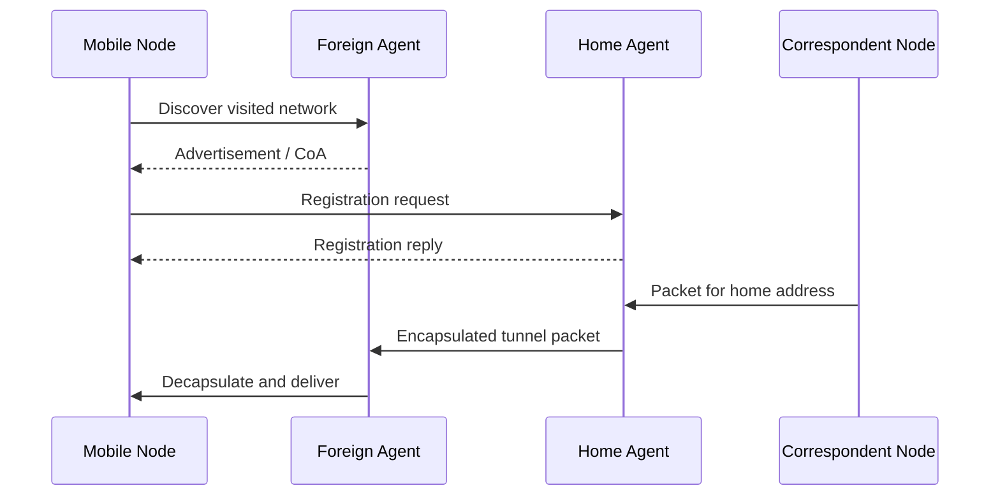

# Q2 – Mobile IP and Mobility Management (7 Marks)

## Aim
Explain how a mobile node retains a home address while moving to a visited network, and model registration and tunnelling.

## Entities
- **Mobile Node (MN):** device that changes network attachment.
- **Home Agent (HA):** stores the binding from home address to current Care-of Address.
- **Foreign Agent (FA):** visited-network agent in traditional Mobile IPv4.
- **Correspondent Node (CN):** peer communicating with MN.
- **Care-of Address (CoA):** current reachable location of MN.

## Registration and delivery
1. MN detects a visited network through agent advertisement or solicitation.
2. MN obtains a CoA.
3. MN sends registration request containing home address and CoA.
4. HA authenticates and accepts/rejects the request.
5. HA stores the binding for the granted lifetime.
6. CN sends packet to MN home address.
7. HA intercepts, encapsulates and tunnels packet to CoA.
8. FA/tunnel endpoint decapsulates and delivers the original packet.

## Challenges
Registration delay can pause communication. Tunnelling adds an outer header. Triangular routing may create a longer CN→HA→MN path. Handoff can cause packet loss. Registration must be authenticated and protected from replay/forged bindings. HA binding state and signalling load affect scalability.

## Improvement for frequent handoff
Use efficient movement detection, avoid unnecessary registrations, buffer packets during short handoff, authenticate updates and consider secure route optimisation where supported. Buffering reduces loss but adds storage and possible delay.

## Result
Mobile IP maintains a stable home address by updating HA binding and tunnelling packets to the current CoA. It improves reachability but adds registration delay and encapsulation overhead. Run program for `outputs/Q2_MobileIP_Results.csv`.
