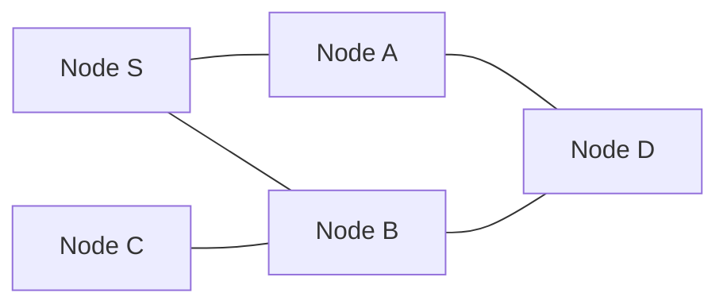

# Q5 – Proactive Routing Protocols in Mobile Networks (6 Marks)

## Proactive routing
A proactive protocol maintains routes before data is sent. Nodes periodically exchange route information. This reduces route discovery delay when a route is current, but consumes bandwidth and energy even when traffic is idle.

## DSDV operation
Destination-Sequenced Distance Vector (DSDV) is table-driven. Each route includes destination, next hop, hop count and destination sequence number. A newer sequence number represents fresher route information. For equal sequence numbers, a lower hop count is preferred. A broken route is advertised with an infinite metric and updated sequence number.

## Sample topology

Before failure S can reach D through A or B. If A–D fails, that route is invalidated; S–B–D can be selected after update propagation.

## Performance
Periodic control packets increase with network size and update frequency. Larger networks require more routing traffic. Frequent topology changes can cause repeated updates and temporarily stale routes.

## Result
DSDV is useful when destinations are frequently contacted and low route setup delay matters. Its trade-off is periodic control overhead. Run program for `outputs/Q5_DSDV_Overhead.csv`.
