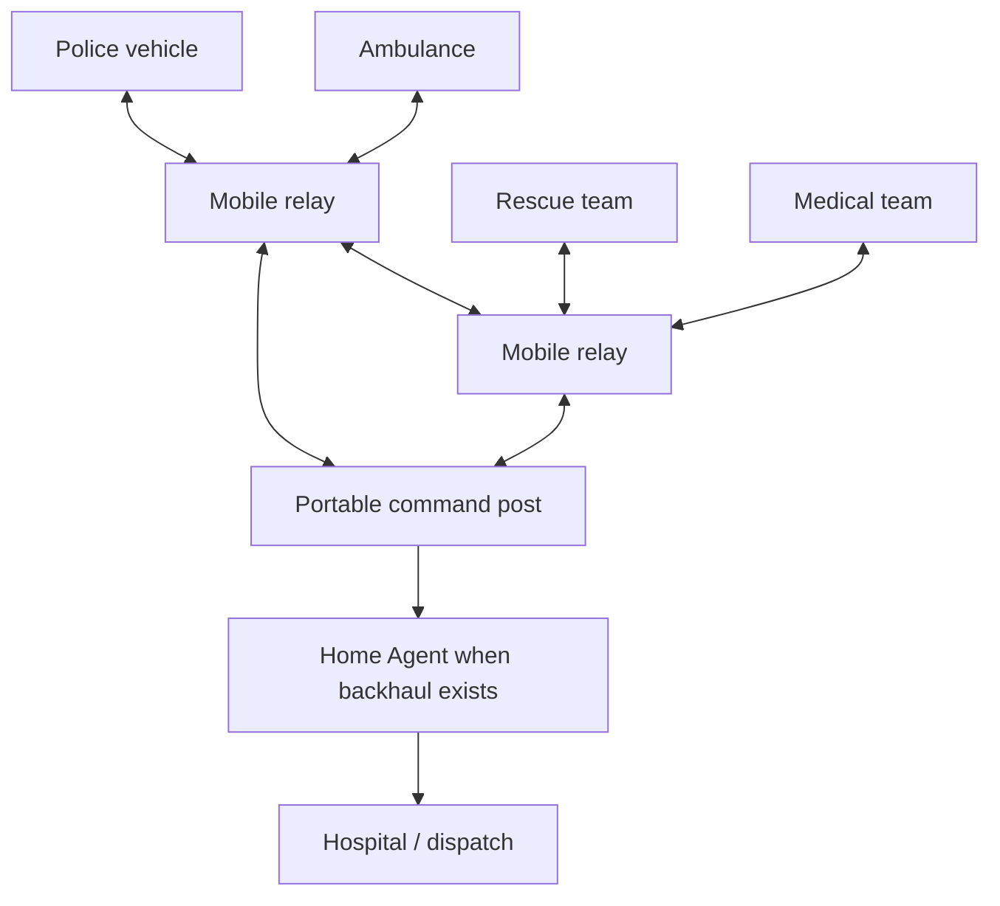

# Q7 – Design a Mobile Emergency Communication Network (10 Marks)

## Scenario
Ambulances, police vehicles, rescue teams and medical personnel move across a disaster area. Fixed cellular infrastructure/backhaul may be unavailable. Critical alerts and patient information must be exchanged with low delay.

## Stage 1 – Initial design proposals (template to validate as a pair)
**Student A – architecture and mobility proposal:** Hybrid wireless architecture: mobile ad hoc multi-hop links between emergency teams, plus a portable command-post gateway when available. Preserve stable service identity with Mobile IP when a reachable HA/backhaul exists. Buffer packets during handoff and register at the new CoA.

**Student B – routing and experiment proposal:** Use AODV for on-demand multi-hop route discovery in the changing topology. Monitor neighbours, use RERR on broken links, rediscover routes when required, and test node count, mobility, delay, PDR and routing control messages.

These are suggested starting proposals. The pair should discuss, edit and retain their actual individual proposals; this template is not evidence that a discussion occurred.

## Stage 2 – Compare
Both proposals use mobile nodes, changing links, fallback networking and performance tests. Student A focuses on stable IP identity and registration; Student B focuses on finding paths through mobile relays. Mobile IP maintains reachability across IP networks; AODV discovers paths inside a changing ad hoc network. They solve different problems.

## Stage 3 – Joint final architecture
- Mobile nodes: ambulance, police, rescue and medical terminals.
- Wireless links: direct peer and multi-hop relay links.
- Portable command post: gateway to surviving backhaul.
- Mobile IP: MN, HA, FA/visited network and CN when IP mobility is required.
- Routing: AODV inside the ad hoc segment.
- Fallback: local multi-hop service during Internet/backhaul outage; store-and-forward queues messages for reconnection.

## Registration and tunnelling
When backhaul and HA are reachable, MN obtains a CoA and registers it. HA intercepts packets addressed to its home address and tunnels them to the CoA. If HA/backhaul is unreachable, Mobile IP cannot provide remote reachability at that time; local ad hoc communication and queued delivery remain available.

## Stage 4 – Validation plan
Test 10, 25 and 50 nodes; low, medium and high mobility; and link failure levels 0%, 5%, 15% and 20%. Record average delay, PDR, lost packets and routing-control messages. Compare AODV demand-driven discovery with DSDV periodic updates. CSV results are deterministic illustrative model outputs, not field measurements.

## Stage 5 – Cross-defence
- Student A: explain why AODV suits intermittent communication over changing peer paths and discuss route-discovery delay.
- Student B: explain how HA binding and tunnelling preserve reachability after a new CoA is registered.

## Stage 6 – Evaluation and limitations
The hybrid architecture works when teams remain within radio range and enough relay nodes are connected. AODV adapts to broken paths but can incur discovery delay and broadcast overhead. Mobile IP adds registration/encapsulation overhead and needs a reachable HA for remote delivery. During complete radio isolation, no routing protocol can deliver packets; queue them for later. The design is less suitable with sparse nodes, exhausted batteries, severe interference or strict real-time guarantees that cannot be met.

## Conclusion
Evaluate infrastructure availability, topology dynamics, node density, mobility speed, traffic rate, bandwidth, delay target, loss tolerance, security, energy, control overhead and expected disconnection duration before selecting Mobile IP and a routing protocol.
