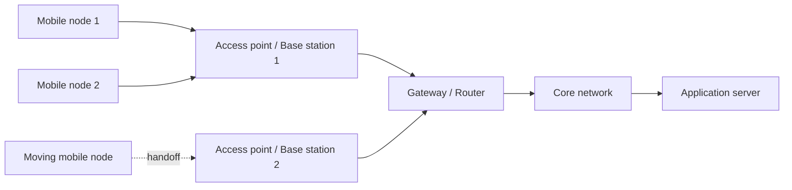
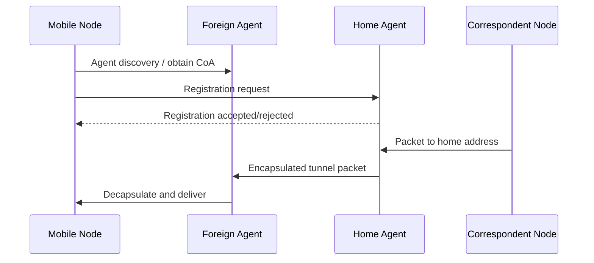
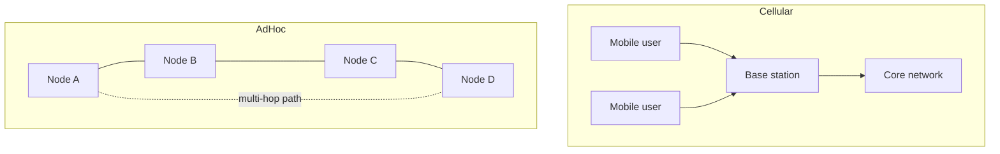
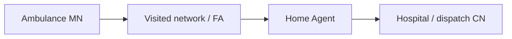
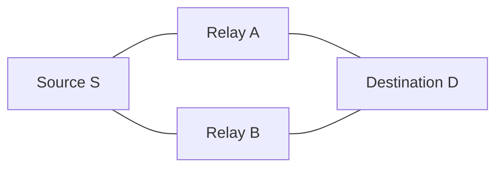
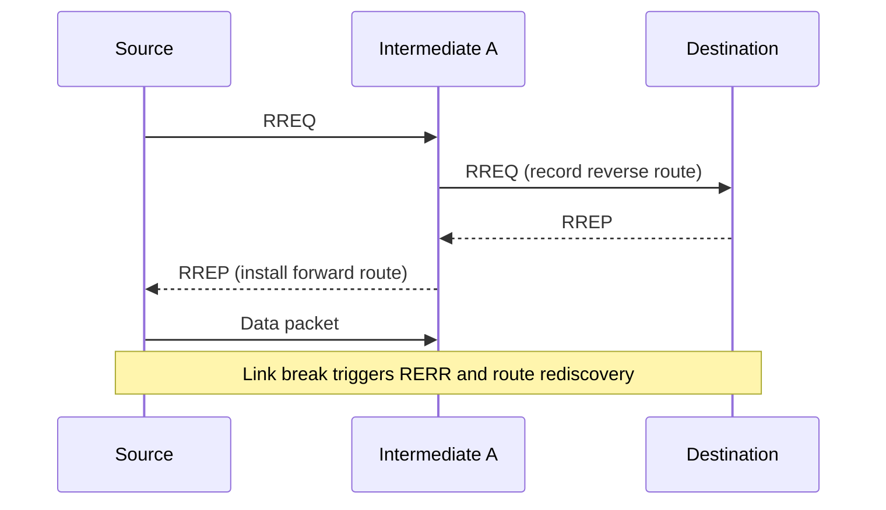
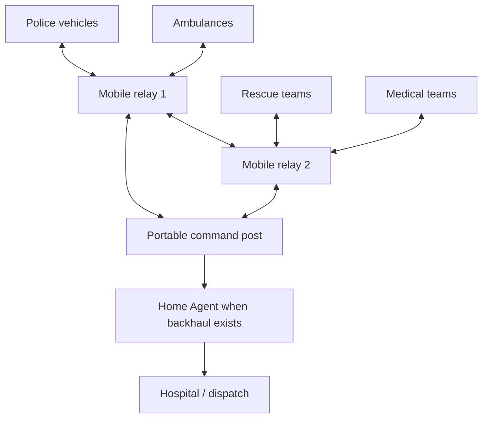

# Assignment 3 – Network Patterns and Flow Diagrams

## Q1 – Wireless network architecture

## Q2 – Mobile IP registration and packet delivery

## Q3 – Cellular and ad hoc patterns

## Q4 – Ambulance Mobile IP application

## Q5 – DSDV route update

## Q6 – AODV discovery

## Q7 – Disaster response hybrid network

