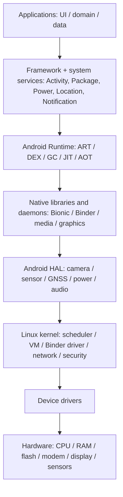
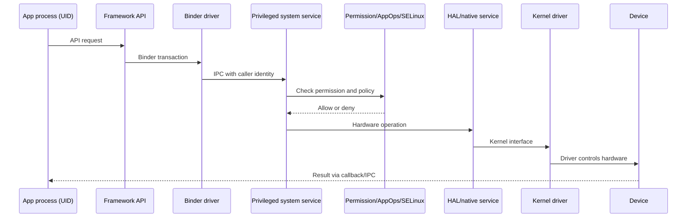
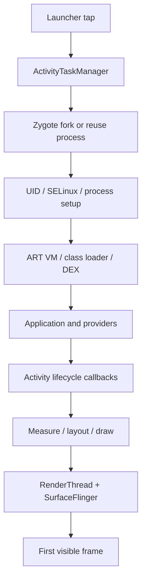
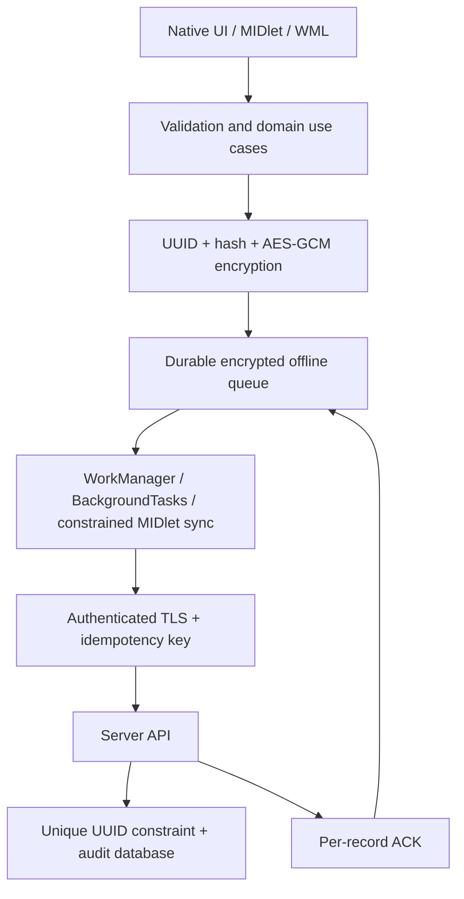
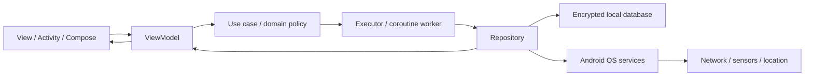
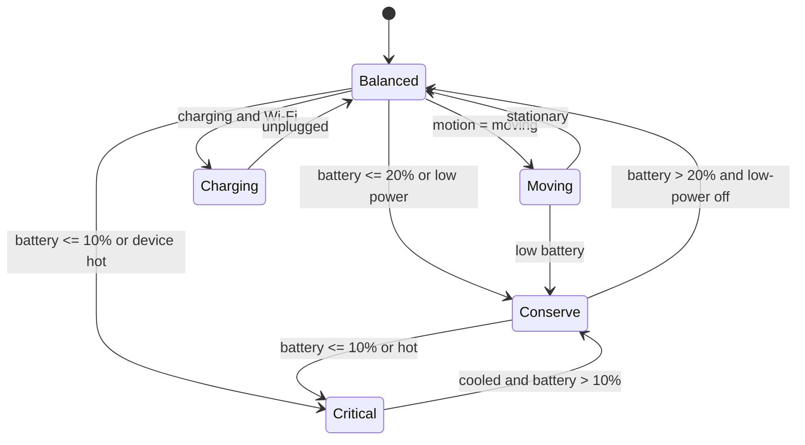

# Assignment 4 — Figures and Build Patterns

## Figure 1: Android layered architecture (Part I Task 1)

## Figure 2: Secure application call and enforcement path

## Figure 3: Android process launch and first frame (Part I Task 3)

## Figure 4: RuralCare offline-first architecture (Part I Task 6)

## Figure 5: Part II MVVM and worker execution pattern

## Figure 6: Battery-aware tracking policy state machine

## Build/test patterns
- **Part I:** design/specification only; no SDK, emulator or source code.
- **Part II:** separate UI, domain, data and OS-service adapters. Keep policy evaluation pure and deterministic; inject clock/network/battery inputs for tests.
- **Security invariant:** encrypt before persistence; authenticate TLS before upload; do not mark records synced before server ACK.
- **Power invariant:** no permanent wakelock; batch sensors/network; emergency override is explicit and logged.
- **Validation:** every test has input, expected decision, actual output, evidence source and interpretation.
